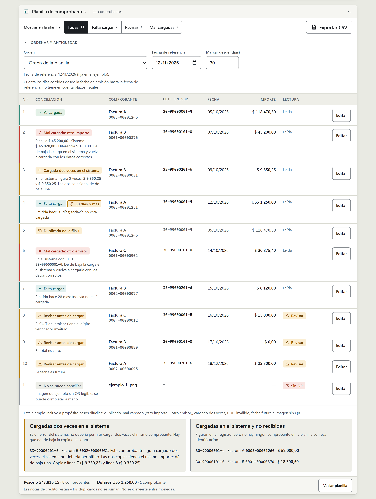

# Lector y conciliador de facturas

## In English

An invoice reader and reconciler: it reads Argentine electronic invoices (PDF or image with the ARCA QR code) and matches them against a CSV exported from a management system, showing which invoices still need to be entered, which were entered wrongly and which were entered twice. It runs entirely in the browser and all data is fictional.

A second tab, **Payments**, closes the cycle: it matches a bank-style payments CSV against the invoices and shows which are paid, partly paid or unpaid, and which payments have no invoice, are duplicated or were authorized by the person who entered them.

Stack: TypeScript and Vite, with only `pdfjs-dist` and `jsqr` in production; the matching is a deterministic rule, with no AI in the browser.

Live demo: <https://facturas.matiasormeno.com.ar>

Run it locally (Node 24, npm 11): `npm install`, `npm run dev`, `npm test`.

Conceived, designed and directed by Matías Ariel Ormeño; built with AI.

The rest of this README and the code identifiers are in Spanish.

Lee facturas electrónicas argentinas (PDF o imagen con el QR de ARCA) y las cruza con un CSV exportado del sistema de gestión.
Responde en segundos qué facturas recibidas **falta cargar**, cuáles están **mal cargadas** y cuáles figuran **cargadas dos veces**.
Para administración y cuentas a pagar. Todo corre en el navegador y todos los datos son ficticios.

**Demo en vivo:** <https://facturas.matiasormeno.com.ar>

## Capturas

Todas con datos ficticios (botón "Ver un ejemplo completo").





## Qué hace

- **Lee** facturas (PDF, imagen o dirección de QR pegada) y arma una planilla. Marca como **Revisar** los datos dudosos (CUIT inválido, total en cero, fecha futura).
- **Concilia** la planilla con el registro del sistema, comprobante por comprobante: **Falta cargar**, **Ya cargada**, **Mal cargada** (otro importe u otro emisor) o **Cargada dos veces**. También lista las **Cargadas en el sistema y no recibidas**.
- **Indica la antigüedad** de lo que falta cargar y permite ordenar por los más antiguos.
- **Permite corregir** filas a mano y **exportar la planilla a CSV** para Excel.
- **Concilia los pagos** (pestaña **Pagos**): cruza un extracto de pagos con las facturas de la planilla y dice cuáles están **Pagadas**, con **Pago parcial** o **Impagas** (con los días desde la emisión), y qué pagos están **Sin factura**, **Duplicados** o **Para revisar**. Ver la sección siguiente.

La regla del negocio: en el sistema real no se carga dos veces el mismo comprobante. Si una factura quedó mal cargada, se da de baja y se vuelve a cargar; por eso la herramienta nunca sugiere cargar encima de lo que ya está. La decisión siempre es de la persona: la herramienta no carga nada en otro sistema.

El botón **Ver un ejemplo completo** carga facturas y un registro ficticios, con casos difíciles a propósito. Incluye una Factura B (punto de venta 2, N.º 31, $ 9.350,25) que el sistema tiene cargada dos veces con el mismo importe. Las filas 12 a 21 del ejemplo muestran el control del comprobante: total que no cierra por centavos, factura C con IVA, CAE vencido, CUIT del receptor inválido, un duplicado y cuatro filas en orden; su desglose viene en columnas extra del registro de ejemplo. El ejemplo no incluye notas de crédito.

Reglas de cruce completas, qué no hace y casos que no resuelve: [docs/reglas.md](docs/reglas.md).

## Pagos: qué facturas se pagaron

La pestaña **Pagos** es la segunda mitad del ciclo (factura recibida, cargada, pagada). Usa las facturas de la planilla y un **extracto de pagos** en CSV (`Fecha` e `Importe`, más `CUIT` y/o `Referencia`; opcionales `Concepto`, `Cargó`, `Autorizó` y `Operación`). El botón **Ver un ejemplo de pagos** carga las facturas de ejemplo y un extracto ficticio de diez pagos, uno por cada resultado.

- **Resumen:** una cifra, «Falta pagar», con el saldo en pesos, y la lista de lo que requiere atención.
- **Facturas:** cada una con su estado (pagada, pago parcial con el saldo, impaga con los días) y qué líneas del extracto la pagaron.
- **Pagos:** cada pago con la factura a la que se aplicó y **por qué** (la regla que lo emparejó, escrita en una frase).
- **Excepciones:** pagos sin factura, para revisar (con las facturas que podrían ser), duplicados, con un número de operación repetido (otro CUIT u otro importe), cargados y autorizados por la misma persona, CUIT inválidos, líneas ilegibles y facturas que no entran al cruce.
- **Exportar:** dos CSV (facturas con su estado de pago, y pagos con su resultado), con las celdas de texto protegidas contra fórmulas.

El cruce es determinístico y sin IA: referencia de la factura, CUIT e importe, o suma de facturas; lo dudoso no se decide, queda para revisar. **No aplica reglas fiscales**: no calcula percepciones, retenciones ni alícuotas (un pago menor que la factura es un pago parcial) y perdona hasta 2 centavos de diferencia. Solo concilia facturas en pesos. Reglas completas en [docs/reglas.md](docs/reglas.md).

## Cómo se usa

1. **Cargue facturas:** arrastre PDF o imágenes con el QR de ARCA (hasta 15 MB cada una) o pegue sus direcciones. Si no tiene una factura a mano, use una de las **facturas de ejemplo en PDF**: están en [`public/ejemplos/`](public/ejemplos/) y se descargan desde el enlace «Descargar una factura de ejemplo (PDF ficticio)» de la página. Son ficticias: empresa, CUIT, importes y CAE inventados, con la leyenda «EJEMPLO — COMPROBANTE FICTICIO, SIN VALIDEZ FISCAL». Su QR tiene el formato real de ARCA (una dirección con un JSON en base64), pero apunta a datos inventados, así que sirven para ver la lectura de un PDF de punta a punta sin usar ningún comprobante real.
2. **Sume lo ya cargado (opcional):** suba el CSV que exporta su sistema. Con las tres facturas de ejemplo y el botón «Probar solo con un registro de ejemplo», una figura como «Ya cargada» y las otras dos como «Falta cargar».
3. **Lea el resultado, revise y exporte** a CSV.

Las tres facturas de ejemplo las genera [`scripts/generar-pdfs.ts`](scripts/generar-pdfs.ts) sin ninguna biblioteca: el PDF y el código QR están escritos a mano en `scripts/pdf-ejemplo/` (el QR se comprueba en los tests contra jsQR). Para regenerarlas: `npm run ejemplos-pdf`. Un test comprueba que los archivos versionados coincidan con lo que produce el script.

## Cómo correrla

Requisitos: Node 24 y npm 11.

```powershell
npm install
npm run dev        # http://localhost:5173
npm test           # tests (vitest)
npm run build      # tipos y genera dist/
```

Prueba en el navegador de la lectura de un PDF real (no forma parte de `npm test`; necesita Python con Playwright y la demo corriendo): `python scripts/e2e-pdf-ejemplo.py`.

## Decisiones técnicas

- **Sin framework:** TypeScript y Vite; solo `pdfjs-dist` y `jsqr` en producción, con versión fija.
- **Lectura del QR en un Web Worker con límite de tiempo:** una imagen pesada no congela la interfaz; si un archivo tarda más de 30 segundos, se corta y la fila queda "Sin QR" con el motivo.
- **`pdf.js` sin `eval`:** los PDF se tratan como entrada hostil (tamaño máximo, sin evaluación de código).
- **Política de contenido sin conexiones externas** (`public/_headers`): los archivos no salen del navegador. No hay servidor, base de datos ni analítica.
- **Detección de codificación del CSV:** UTF-8, UTF-16 con marca (el "Texto Unicode" de Excel) o Windows-1252; separador `;`, `,` o tabulador.
- **CSV exportado protegido contra fórmulas:** las celdas que empiezan con `=`, `+`, `-` o `@` se neutralizan.
- **Cruce determinístico, sin IA:** comparar cuatro campos y un importe al centavo no la necesita, y una regla fija da siempre el mismo resultado y se prueba con tests.
- **Control de coherencia, no reglas fiscales:** cada fila con QR se revisa contra sí misma (CUIT del emisor y del receptor, CAE, fecha de emisión, y que el total cierre cuando se conoce el desglose) y lo dudoso se marca como error o aviso. No calcula percepciones, retenciones ni alícuotas, ni consulta padrones. Dos observaciones son coherencia interna y no una regla de impuestos: «una factura C no discrimina IVA» y «una A se emite a un receptor con CUIT»; salen como aviso o error según lo que contradigan, y la decisión sigue siendo de la persona. «Hoy» es el día de Argentina, porque las fechas de los comprobantes lo son. **Límite honesto:** el QR de ARCA no trae el neto ni el IVA. Por eso el cuadre del total, la letra C con IVA y el vencimiento del CAE solo se controlan si ese desglose viene del registro (columnas opcionales Neto, IVA, Otros y Vencimiento CAE, que un CSV sin ellas simplemente no trae) o se escribe a mano en el detalle de la fila; y lo escrito manda sobre el registro. La demo no lo calcula: lo informa quien carga (ver [docs/reglas.md](docs/reglas.md)).
- **814 tests** (46 archivos): QR, CUIT, duplicados, control de coherencia del comprobante, CSV, cada resultado de la conciliación, notas de crédito (cubiertas por tests, no por el ejemplo), el conciliador de pagos (cruce, textos, exportación y pestañas), importes y textos para lectores de pantalla.
- **Límite de la verificación del QR:** la lectura del QR se probó con códigos generados para esta demo (los PDF de ejemplo y los de las pruebas). La prueba con comprobantes reales de ARCA todavía está pendiente.

## Cómo se hizo (uso de IA)

- **Herramienta:** Claude (Anthropic), usado como programador bajo dirección.
- **Para qué:** escribió el código y los tests a partir del diseño que Matías aprobó.
- **Qué decidió y verificó Matías:**
  - El alcance y que la persona decide: la página nunca carga nada en otro sistema.
  - Comparar el importe al centavo exacto, sin tolerancia, al conciliar contra el registro. En la pestaña Pagos, en cambio, se perdonan hasta 2 centavos entre un pago y un saldo.
  - La regla del negocio de la conciliación: el sistema real no permite cargar dos veces el mismo comprobante, así que lo mal cargado se da de baja y se vuelve a cargar, y lo que figura dos veces es un error del sistema.
  - Que el cruce sea una regla determinística, sin IA en el navegador. Y que ante un "otro emisor" ambiguo no se acuse a una fila vecina sino que decida la persona.
  - Qué dejar fuera: lectura de texto de PDF sin QR, XLSX y consulta a ARCA.
  - Probó cada tanda y aprobó cada cambio de texto y de diseño.
- **Responsabilidad:** del autor. El código lo escribió una IA; Matías diseñó, decidió y verificó.

## Origen y licencia

Proyecto de Matías Ariel Ormeño, iniciado el 17/11/2026. Escrito desde cero, con datos 100 % ficticios (empresas, CUIT, importes y CAE inventados). El código de la aplicación es propio; las únicas bibliotecas de terceros que usa en producción son `pdfjs-dist` (lectura de PDF) y `jsqr` (lectura del QR). No usa datos ni documentos de terceros.

Licencia: MIT (ver LICENSE).
